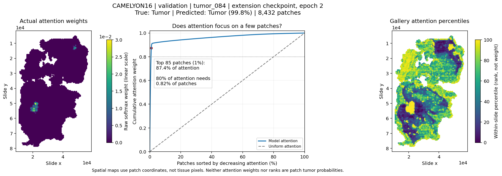
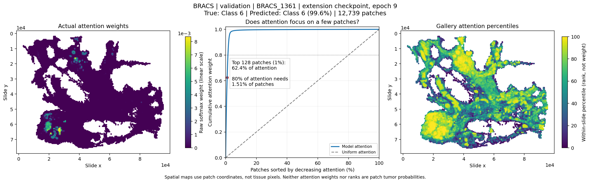

# ECE1512 Project A
## Attention-Based Multiple Instance Learning for Whole-Slide Classification
### Baseline evaluation, masked-view consistency and gated spatial context

Parteek Dheri

Digital Image Processing and Applications, University of Toronto

October 26, 2026

Repository: https://github.com/dheri/ECE1512_Project-A

<!-- columns -->
### Abstract

Whole-slide classification requires learning from many patches with only a slide label. This project evaluates the supplied attention-based multiple instance learning (ABMIL) pipeline and two extensions: prediction consistency between a full bag and a randomly masked view, and gated residual context from nearby patch coordinates. The main comparison comprises 90 fresh runs: three methods, three datasets and ten paired training seeds, with 30 completed epochs per run. CAMELYON17 uses patient-disjoint training, validation and test partitions; CAMELYON16 and BRACS retain their frozen partitions. Mean baseline test accuracy is 87.67% on CAMELYON16, 77.45% on CAMELYON17 and 42.21% on BRACS. Gated spatial context increases mean accuracy by 2.02, 2.30 and 1.16 percentage points, respectively, but does not improve every metric: BRACS macro AUROC decreases by 0.0081, and CAMELYON17 test cross-entropy increases. The 90%-retention consistency objective produces small, mixed changes rather than a reliable improvement. Earlier three-seed controls help explain the designs, but are kept separate from the main results. Ten seeds expose the fragility of conclusions drawn from three runs. These are exploratory fixed-split findings, not a claim of clinical validity or independent confirmation after model development.

Keywords: whole-slide imaging, weak supervision, attention pooling, consistency regularization, spatial context.

### I. Introduction

A whole-slide image can contain thousands of informative and uninformative tissue patches. Annotating every patch is expensive, whereas a diagnosis may be available for the slide. Multiple instance learning (MIL) treats a slide as a variable-size bag of patches and learns its label without requiring patch labels. The familiar binary MIL assumption, “one positive instance makes a positive bag,” motivates metastasis detection. It is not a complete description of every multiclass histology task.

<!-- column -->
ABMIL [1] replaces fixed mean or max pooling with learned instance weights. Its simplicity makes it a useful baseline: feature extraction, aggregation and classification are distinct, and attention can be inspected at patch coordinates. However, independently scoring patches does not explicitly model their neighborhood, and bag-level supervision does not guarantee reliable predictions for rare classes.

This project asks three questions.

1. Can a modest coordinate-based residual improve ABMIL without replacing its pooling mechanism?
2. Does matching predictions after removing 10% of patches improve full-bag classification?
3. Which conclusions survive increasing a matched comparison from three to ten training seeds?

Both proposed extensions are implemented, exceeding the requirement to evaluate one [10]. The spatial model preserves the baseline prediction at initialization and learns how much local context to add. The consistency model leaves the architecture unchanged and adds a detached full-to-masked Kullback–Leibler (KL) term during training.

### Scope of the evidence

The main study fixes the data, optimizer, epoch budget and checkpoint rule, then reports every seed. It includes accuracy, macro AUROC, macro F1 and ordinary test cross-entropy. Paired differences describe how each extension changes the result for the same seed.

Earlier experiments influenced the final designs, and their test results had already been inspected. Consequently, the main study improves the estimate of training-seed variability but does not restore an untouched test set. Its strongest supported finding is a positive mean accuracy change for gated spatial context on the three available datasets, accompanied by important ranking, loss and minority-class limitations.

The rest of the report first reviews five representative methods, then describes the data and baseline, defines the extensions, analyzes the ten-seed results and revisits the earlier controls. Reproducibility checklists distinguish what the report documents from what the code package supplies.
<!-- /columns -->

<!-- page -->
## II. Literature Review

<!-- columns -->
### A. ABMIL: learning the aggregation rule

Ilse, Tomczak and Welling [1] frame bag prediction as an instance transformation, a permutation-invariant aggregation operator and a bag classifier. Mean pooling can dilute sparse diagnostic evidence; max pooling can discard useful contributions from other instances. Their attention operator learns nonnegative weights that sum to one, allowing a bag-dependent weighted representation. A gated version multiplies tanh and sigmoid transformations before scoring each instance.

The bag likelihood trains the feature and pooling networks jointly. In this project, image features are already extracted, so only the subsequent projection, pooling and classifier learn. ABMIL is efficient and produces inspectable weights, but a patch's score is computed without explicit interaction with other patches before pooling. Attention is a relative contribution to a representation, not a calibrated instance label. This distinction is present in the original paper and matters when interpreting a bright region.

### B. CLAM: extracting more supervision from each slide

Lu et al. [2] address data efficiency with clustering-constrained attention MIL. Attention identifies strongly and weakly attended instances; these become representative examples for auxiliary instance-level clustering. In the class-specific multi-branch formulation, separate attention branches construct representations for different diagnoses. The slide label and, where appropriate, mutual exclusivity of subtypes constrain which selected instances provide positive or negative evidence.

CLAM therefore adds a learning signal beyond the bag classification objective. Its pseudo-instance labels are model-generated, not extra pathologist annotations. This can enrich a weakly supervised feature space but also makes the quality of selected instances important. Single-branch and multi-branch variants are not interchangeable. The present project does not implement CLAM's clustering heads or claim to reproduce its results.

### C. DSMIL: relating patches to a critical instance

Li, Li and Eliceiri [3] use two streams. An instance classifier followed by max pooling identifies the highest-scoring, or critical, instance. A second stream aggregates transformed instance features using learned query similarity to that critical instance. The streams' scores are averaged. For multiclass classification, the critical-instance and aggregation operations can be performed per class.

This introduces an interaction between instances without constructing ordinary all-pairs self-attention. The paper also studies self-supervised contrastive feature extraction and pyramidal multiscale features. Those are distinct contributions, not properties automatically inherited by any dual-stream pooling implementation. Reliance on a critical instance can be useful for sparse positive evidence, but a wrongly selected instance can distort the context used by the second stream.

<!-- column -->
### D. TransMIL: correlated instances and position

Shao et al. [4] explicitly model correlated instances. TransMIL projects patch embeddings, pads the sequence to a square arrangement and introduces a class token. Two transformer layers surround a Pyramid Position Encoding Generator (PPEG). PPEG uses convolutional kernels of sizes 3, 5 and 7 to incorporate positional and local information after arranging patch tokens in two dimensions.

Nyström attention approximates self-attention to accommodate long bags. Thus TransMIL addresses both expressive patch interaction and its computational cost. The token arrangement and positional processing are part of its design; it should not be equated with a nearest-neighbor graph defined directly on the supplied coordinates. The spatial extension here asks a narrower question: whether a local residual added to the existing ABMIL representation is useful.

### E. DTFD-MIL: more training bags and a second tier

Zhang et al. [5] address the mismatch between many patches and relatively few labeled slides. Instances are randomly divided into pseudo-bags that inherit their parent slide label. A first-tier attention model learns from the pseudo-bags, distills representative features, and passes those features to a second-tier MIL model for the parent-slide prediction. The paper derives instance class scores using a Grad-CAM-based analysis and compares maximum selection, maximum/minimum selection, maximum-attention selection and aggregated-feature selection.

A positive slide's pseudo-bag may contain no positive instance, making its inherited label noisy. The second tier is intended to use the distilled evidence more effectively. Pseudo-bags do not create new independent patients. Similarly, the masked views in this project do not enlarge the number of independently labeled slides. Unlike DTFD-MIL, the proposed consistency objective has no second-tier model or hard label for the masked view.

### F. Comparison and research gap

The five methods intervene at different points: ABMIL learns pooling; CLAM adds instance-level constraints; DSMIL learns relationships to a critical instance; TransMIL models broader correlations and position; DTFD-MIL restructures bags and distills their features.

These differences motivate two controlled modifications rather than a new reproduction of each published architecture. Local context tests whether the supplied coordinates add useful information before pooling. Masked-view consistency tests whether predictions become more useful when training discourages sensitivity to a small random deletion. Neither hypothesis assumes that extra complexity must improve performance.

Published scores are not used as numerical comparators. Feature extractors, slide inclusion, partitions, magnifications and evaluation protocols differ. A fair numerical comparison in this report uses the same supplied features and frozen splits.
<!-- /columns -->

<!-- page -->
## III. Data and Evaluation Protocol

Table I. Available course feature bags and frozen split sizes.

{{table:datasets}}

<!-- columns -->
### A. What is actually available

The course release [9] supplies one 384-dimensional feature vector per patch, its two-dimensional coordinate and a slide label. The available subset contains 398 C16 slides, 499 C17 slides and 537 BRACS slides. These counts describe the supplied feature files, not the total sizes of the original datasets [6]–[8]. In particular, the BRACS publication describes 547 whole slides; only 537 are present here.

The release page identifies the files as course WSI features but does not document the exact encoder, checkpoint, pretraining corpus, patch magnification or coordinate units. Neither the filename `medical_ssl` nor the dimension 384 establishes a specific backbone. Feature extraction is frozen and outside the trained pipeline. This limits any claim about image-level representation quality or physical neighborhood size.

C16 uses the available normal/tumor labels. C17 is evaluated as a four-class slide task, and BRACS as seven classes. C17 and BRACS retain numeric class IDs because the exact mapping from supplied numeric labels to named diagnoses has not been independently established. No tumor-subtype names are inferred from their IDs.

### B. Frozen partitions

C16 retains its supplied test slides and a frozen stratified development split. BRACS preserves the available train/validation/test metadata rather than generating a new random partition.

C17 reserves centers 3 and 4 for test. Development slides from centers 0–2 are divided with `StratifiedGroupKFold(n_splits=10, shuffle=True, random_state=42)`, taking the first fold with all four classes in both development partitions. Fold 0 satisfies the rule. Partition selection uses development labels and patient groups, not test labels, a test metric or a search over seeds.

<!-- column -->
The resulting C17 partitions contain 54 training, 6 validation and 40 test patients, with zero patient overlap between any pair. Test membership and order are unchanged from the earlier experiments. The validation patients are 0, 10, 30, 38, 51 and 53.

C17 class counts are 177/19/36/37 for training, 20/1/5/4 for validation and 121/16/18/45 for test. A single class-1 validation slide makes checkpoint selection sensitive to that example. Patient independence fixes one leakage concern; it does not make this a large or balanced validation set. The task is not the original challenge's patient-level nodal staging evaluation [7]. Patient-disjointness is explicitly established for C17, not asserted for datasets without equivalent group metadata.

### C. Metrics and checkpoint selection

Accuracy is the percentage of slides whose highest-probability class matches the label. Macro F1 averages the per-class F1 scores equally. Macro AUROC averages one-versus-rest class AUROCs, including both class columns for C16 as implemented by the supplied metric helper. Test cross-entropy is ordinary, unweighted negative log-likelihood on full bags. No threshold optimization or class reweighting is used in the main comparison.

Every run completes 30 epochs. The selected checkpoint is the first epoch attaining the maximum validation macro AUROC plus macro F1. Test performance never chooses an epoch or a “best seed.” Selection is not early stopping: later epochs still run and are recorded.

### D. Paired seeds and uncertainty

The primary grid is three methods × three datasets × ten seeds, 42–51. The same split membership and ordering are used for every seed and method. Differences are extension minus baseline for the same seed. Summaries use the sample standard deviation, with denominator nine.

These SDs describe variation from training initialization and stochastic training on one fixed partition. They are not confidence intervals and do not quantify uncertainty across patients, centers or new split draws. Seed wins are descriptive counts, not ten independent clinical replications. No statistical-significance test is claimed.
<!-- /columns -->

<!-- page -->
## IV. ABMIL Baseline: Architecture and Training

<!-- columns -->
### A. From patch features to a slide prediction

For a slide with N patches, the input is a matrix X with shape N × 384. A learned linear projection followed by ReLU produces hᵢ in 256 dimensions:

> hᵢ = ReLU(Wₚxᵢ + bₚ).                                              (1)

The projection adapts the fixed input representation to the slide task. It is not an image encoder trained from tissue pixels. The feature extractor has already run before these experiments.

The aggregator follows the gated attention form of ABMIL [1]. Two 128-dimensional transformations produce an attention logit sᵢ for each projected patch. Their product in (2) is elementwise:

> sᵢ = wᵀ[tanh(Vhᵢ + bᵥ) ⊙ sigmoid(Uhᵢ + bᵤ)] + bₛ.             (2)

Softmax normalizes over the real patches of that slide:

> αᵢ = exp(sᵢ) / Σⱼ exp(sⱼ),      z = Σᵢ αᵢhᵢ.                     (3)

The weighted sum z has 256 dimensions regardless of bag size. A linear classifier maps it to C logits, with C equal to 2, 4 or 7:

> ℓ = W꜀z + b꜀,      p = softmax(ℓ).                                (4)

The classifier converts the bag representation into competing slide-level class scores. Cross-entropy receives raw logits and integer slide labels; applying softmax before that loss would be incorrect.

### B. Why this is a MIL model

Each slide supplies one supervised label, although it contains many patch embeddings. There is no patch classifier trained against patch labels in this baseline. Attention weights are nonnegative and sum to one within a bag. The combination of independent patch transformations and a weighted sum makes the result invariant to reordering the real patches.

The loader supports padding and a Boolean mask, where true denotes a real patch. Padded logits are excluded before attention softmax. Masked padding must not affect the prediction. In the reported experiments the batch size is one slide, so different slides do not need padding to a common bag size.

<!-- column -->
### C. Optimization

All methods use full training splits, one slide per batch, AdamW with learning rate 10⁻⁴ and weight decay 10⁻⁵, and 30 epochs. Dropout is zero. No learning-rate scheduler, warm-up schedule, encoder fine-tuning, few-shot selection or residual block is added. The starter configuration fields `warmup_epoch` and `n_res` are unused in this model, rather than silently activating extra behavior.

The training loader shuffles slides; validation and test loaders preserve their saved order. Lazy HDF5 loading reads one bag at a time, avoiding an in-memory copy of all features. All 90 primary runs use one serial GPU worker, two CPU threads and zero loader workers. They ran on an NVIDIA GTX 1080 Ti with Python 3.12 and PyTorch 2.5.1+cu121.

The update sequence is `train`, clear gradients, forward pass, loss, backpropagation and optimizer step. Validation uses evaluation mode and disables gradient tracking. Those operations serve different purposes: evaluation mode changes behavior of layers such as dropout, while disabling gradients prevents graph construction and parameter-gradient accumulation.

### D. Implementation checks

Synthetic tests cover output shapes for 2/4/7 classes, attention normalization, masking and permutation behavior. The experiment verifier checks complete histories, validation-based epoch selection, saved predictions, confusion matrices and exported images. The completed notebook supplies the baseline model and training/evaluation definitions; the command-line runner reuses those definitions rather than maintaining a second baseline implementation.

The model/training definition fingerprint is unchanged in the clean notebook. Packaging removes saved execution output and replaces installation and split-loading setup, not the trained equations. The notebook now loads the final frozen partitions so that running C17 does not silently recreate the earlier overlapping development split.

### E. Evaluation budget

Thirty equal epochs control the number of passes through training slides, not elapsed time or total computation. Consistency requires an additional masked forward pass. Spatial context adds an MLP, a gate and neighbor processing. This study is therefore not an equal-FLOP, equal-memory or matched-runtime comparison.
<!-- /columns -->

<!-- page -->
## IV. Baseline Evaluation

Table II. ABMIL test results, ten seeds. Values are mean ± sample SD.

{{table:baseline}}

<!-- columns -->
### F. Observations across datasets

C16 is the strongest baseline in both accuracy and macro F1. Its selected checkpoints occur very early: epoch 2 for seed 42 and epoch 3 for the remaining nine seeds. A 27-slide validation set can saturate early. Continued training is not evidence that the later model is preferable; the recorded validation rule determines the tested checkpoint.

C17 accuracy is substantially higher than macro F1 would suggest. Its test set is dominated by classes 0 and 3, whereas classes 1 and 2 contain only 16 and 18 slides. Section VIII examines this imbalance directly. The baseline's selected epochs span 5–30, showing greater checkpoint variability than C16.

<!-- column -->
BRACS is the most difficult of the three available tasks. A macro AUROC of 0.8057 coexists with accuracy of 42.21% and macro F1 of 0.3530. One-versus-rest ranking and a seven-way argmax decision measure different properties: useful ranking does not guarantee well-separated class decisions.

Figure 1 includes training and validation loss rather than only the final test score. The gap between training fit and validation behavior motivates regularization, but it does not identify which regularizer should help. Neither a visually smooth curve nor a low training loss justifies selecting settings using test performance. The two extension designs are evaluated against this fixed baseline in the same ten-seed cohort.
<!-- /columns -->

<!-- page -->
## V. Two Research Extensions

<!-- columns -->
### A. Proposal 1: full-to-masked prediction consistency

Motivation: an aggregation model may rely too heavily on a small subset of patches. If removing a modest random fraction leaves the underlying slide diagnosis unchanged, encouraging prediction agreement could regularize the classifier without changing its architecture. However, if critical evidence is sparse, patch removal can erase the only positive evidence and make that assumption wrong.

For each full bag X, sample a subset M uniformly without replacement. Retain max(1, floor(0.9N)) real patches and use the same model for both views. Let p be the full-bag distribution and q the retained-view distribution. The objective is

> L = CE(y, p) + λ KL(stopgrad(p) ∥ q),      λ = 1.                 (5)

The KL direction is full to masked, with temperature one. Gradients from the KL term reach only the masked prediction; the full prediction still receives supervised cross-entropy gradients. The teacher is the current model's detached full-bag output, not an exponential-moving-average network.

The implementation first backpropagates full-bag cross-entropy, then constructs the masked pass and backpropagates its KL term. There is no optimizer update between the passes, so their gradients accumulate for one update. This avoids retaining two large slide computation graphs simultaneously.

A dedicated CPU random generator, seeded by the training seed, draws the retained subset without consuming the global model/loader random stream. There is no hard-label cross-entropy on the masked view in this proposal. Validation, testing and attention export always use full bags and ordinary cross-entropy.

Expected benefit: improved full-bag generalization without additional inference parameters. Possible failure: the loss may mostly enforce already-similar predictions or suppress sensitivity to rare diagnostic evidence. Classification performance alone does not establish robustness to missing tissue, acquisition artifacts or adversarial deletion. Such tests were not performed.

<!-- column -->
### B. Proposal 2: gated local spatial context

Motivation: neighboring tissue patches may provide context that an independently scored embedding lacks. A local module can introduce interactions without replacing ABMIL with a full transformer. A learnable gate may suppress unhelpful context rather than forcing every patch to use it.

For each patch i, find up to eight nearest other patches by Euclidean distance in the supplied coordinate frame. Let mᵢ be the mean of their projected features and cᵢ the concatenation of hᵢ and mᵢ:

> mᵢ = mean{hⱼ : j ∈ neighbors(i)},      cᵢ = [hᵢ ; mᵢ].        (6)

Define a two-layer context MLP f and a scalar sigmoid gate:

> f(cᵢ) = W₂ ReLU(W₁cᵢ + b₁) + b₂,                              (7)

> gᵢ = sigmoid(wgᵀcᵢ + bg),      h′ᵢ = hᵢ + gᵢf(cᵢ).          (8)

The MLP maps 512 → 256 → 256. It adds 197,120 parameters; the gate adds 513. The unchanged gated-attention pool and classifier operate on h′. This context gate is separate from the tanh/sigmoid gate already inside ABMIL attention.

The final context layer starts at zero. Gate weights start at zero and its bias is log(0.1/0.9), making the initial gate 0.1. Module creation preserves the baseline random-generator state. The initial logits therefore equal the matched baseline logits. At the first update the context gate's task gradient is zero because the residual is zero; it can receive a task gradient once the context output begins learning.

Neighbor construction uses a cKDTree in canonical coordinate order, excludes the patch itself and uses min(8, N−1) neighbors. A singleton receives a zero neighbor mean. Nonfinite or duplicate coordinates are rejected. Preflight checks established finite, unique feature-coordinate alignment for all 1,434 slides. Equidistant tie choices can depend on the SciPy version.

Coordinate proximity does not prove tissue connectivity or a known physical distance. Gaps and missing tissue may connect unrelated regions. A bounded graph cache changes data access, not the objective. Training and inference use full bags, real coordinates and ordinary cross-entropy.
<!-- /columns -->

<!-- page -->
## VI. Primary Ten-Seed Results

Table III. All primary test results. Mean ± sample SD across seeds 42–51. Accuracy is in percent; other metrics are unitless.

{{table:primary}}

Table IV. Paired extension-minus-baseline differences. Accuracy differences use percentage points (pp). Wins count strictly positive differences out of ten for accuracy/AUROC/F1; ties are not wins.

{{table:paired}}

<!-- columns -->
### A. Gated spatial context

Mean accuracy increases on all three datasets, by 2.02 pp on C16, 2.30 pp on C17 and 1.16 pp on BRACS. The spatial model has higher accuracy in 6/10, 7/10 and 5/10 paired seeds, respectively. These counts show that positive means do not mean every run improves.

C17 has the clearest multi-metric improvement: mean AUROC increases by 0.0105 and macro F1 by 0.0381, with F1 improving in nine of ten seeds. Nevertheless, test cross-entropy increases from 0.8059 to 1.0075. Better argmax decisions and rankings can coexist with larger probability errors on some slides.

<!-- column -->
BRACS illustrates a different tradeoff. Spatial accuracy and F1 increase, but AUROC decreases by 0.0081, with only two positive AUROC differences. It would be misleading to call the model uniformly better across metrics or datasets.

### B. Masked-view consistency

Consistency produces no broad advantage. Accuracy changes are −0.39 pp, −0.35 pp and +0.47 pp on C16, C17 and BRACS. AUROC changes are small and mixed. BRACS F1 improves by 0.0086, but this does not establish the regularizer as generally effective.

The final comparison evaluates the prespecified 90% retention and unit KL weight, not an optimized family of consistency models. A negative result at these settings is narrower than a claim that all consistency regularization fails.
<!-- /columns -->

<!-- page -->
## VII. What Ten Seeds Change

Table V. Range of selected checkpoint epochs across the ten seeds.

{{table:selected_epochs}}

<!-- columns -->
### A. Three seeds can change the apparent story

Using only seeds 42–44 from this same new cohort, the C16 baseline mean is 83.72% and spatial mean is 88.63%, an apparent advantage of 4.91 pp. With all ten seeds, the advantage is 2.02 pp. The initial three baseline runs were relatively weak; retaining only those would exaggerate the final mean gain.

For C17, the first-three means are 81.50% for baseline and 80.17% for spatial, a −1.33 pp spatial difference. Across all ten seeds the means are 77.45% and 79.75%, a +2.30 pp difference. This sign change concerns the same patient-disjoint cohort; it is not produced by mixing old and new C17 splits.

<!-- column -->
### B. What the extra seeds do not establish

Figure 2 makes the spread visible. The C16 spatial accuracy difference has sample SD 3.04 pp; C17 has 4.76 pp; BRACS has 3.95 pp. Large positive and negative individual differences make a universal-improvement claim untenable.

The study estimates average behavior over the chosen training seeds more credibly than three runs, but all ten models still see the same patient and slide partitions. Additional seeds cannot replace external validation, repeated patient-level splits or an untouched test cohort.

Checkpoint variability is another source of instability. The C16 selection range is narrow, whereas C17 often selects much later epochs. Reporting the selected epoch for every run, rather than retrospectively choosing a favorable checkpoint or seed, makes that behavior auditable.
<!-- /columns -->

<!-- page -->
## VIII. C17 Failure Analysis

Table VI. Mean per-seed recall by numeric class ID. Test support is unchanged across seeds; recalls are averaged across ten independently trained models.

{{table:c17_recall}}

<!-- columns -->
### A. Accuracy hides weak minority-class recall

Classes 0 and 3 account for 166 of the 200 test slides. The spatial model improves their mean recall to 0.9157 and 0.9489. It also improves class-1 recall from 0.0875 to 0.1187 and class-2 recall from 0.1778 to 0.2278, but both remain low. The direction of improvement is useful; the absolute performance is still poor for these classes.

Mean precision also improves for the spatial model on classes 1 and 2, from 0.1831 to 0.2702 and from 0.2748 to 0.4618. These are means of per-seed precision, not precision recomputed from a pooled ensemble. Models are not ensembled in this study.

The weak rare-class results are consistent with limited training examples and a particularly small class-1 validation set. They do not establish a biological explanation, because named class mappings and tissue-level error annotations have not been verified.

<!-- column -->
### B. Cross-entropy is a necessary counterweight

Spatial context improves C17 accuracy, macro F1 and macro AUROC while increasing mean test cross-entropy by about 0.202. Cross-entropy penalizes low probability assigned to the true class even when the number of correct argmax decisions improves. Thus the loss increase is not inconsistent with the classification gains.

This report does not label the model “better calibrated”: no expected-calibration-error analysis, reliability diagram or recalibration experiment was conducted. The loss finding instead cautions against interpreting accuracy gains as uniformly improved probability quality.

### C. No claim of clinical readiness

The task uses a center-held-out slide subset and numeric four-class labels, not a complete patient-staging pipeline. Its positive seed-level differences do not compensate for poor minority recall. Any clinical claim would require verified label semantics, a clinically appropriate endpoint, independent cohorts and an assessment of patient-level uncertainty.
<!-- /columns -->

<!-- page -->
## IX. Attention Visualization: Baseline

The following examples use the saved primary baseline checkpoint for seed 42. Selection is fixed: the first validation slide in saved order with label 1 for C16, label 1 for C17 and label 6 for BRACS. It does not depend on correctness, confidence or attention. The paired spatial examples on the next page use the same slides.

The middle panels rank patches by attention and accumulate their mass. This indicates concentration, not spatial extent of a lesion. Rank coloring on the right can make small differences look strong, because every slide receives its own ranking. Raw values on the left and the concentration plot should therefore be read together with the ranks. No localization metric or patch ground truth is available for these examples.

<!-- page -->
## IX. Attention Visualization: Gated Spatial Model

These panels reuse the corresponding primary seed-42 gated spatial exports. They are validation diagnostics, not new test-set attention measurements or a selection of the most convincing maps. Slide IDs, predictions and probabilities remain visible in the saved panels.

The maps satisfy the notebook's candidate-region visualization objective without claiming segmentation. Attention weights sum to one within a slide and are not patch tumor probabilities. Raw weights cannot be compared across slides as absolute disease scores. There is no pathologist region annotation or tissue-image overlay in these report examples, so neither localization accuracy nor causal faithfulness is established. The package includes the source PNGs and the deterministic selection record.

<!-- page -->
## X. Supporting Controls and Earlier Experiments

Table VII. Selected earlier paired comparisons, seeds 42–44 only. Entries are mean test-accuracy differences in pp. These 108 earlier runs are supporting evidence, not extra seeds added to the primary 90-run study. “Original” C17 development data share training/validation patients; “Patient-disjoint” uses the corrected partition.

{{table:historical}}

<!-- columns -->
### A. Is extra capacity the same as useful geometry?

The earlier ungated spatial model improved C16 mean accuracy from 83.72% to 88.89%, but reduced BRACS from 42.64% to 39.15%. Shuffling the assignment of coordinates while retaining model capacity gave C16 accuracy of 85.53%. On C17 and BRACS, the shuffled model's means exceeded the real-coordinate model's means for all three principal metrics.

This control weakens a simple “spatial information always helps” explanation. It does not show that geometry is irrelevant in every setting. It used one fixed coordinate-shuffle seed and the ungated architecture. There is no new gated shuffled-coordinate control for the final model, so the primary gains cannot be attributed uniquely to meaningful geometry rather than additional capacity or regularization.

### B. What does the context gate contribute?

The learned gate recovered BRACS mean accuracy to 43.41% in the earlier cohort. A fixed gate gave 43.02%, so the recovery alone does not prove that learning the gate was the decisive mechanism. The compact context MLP reduced its own parameter count from 197,120 to 49,472, a 74.9% reduction, but this is not a 74.9% reduction of the whole model or a measured speedup.

Compact BRACS mean accuracy matched the learned-gate mean, but its sample SD increased from 1.34 to 3.55 pp. The paired correct-slide changes were +2, +2 and −4. Reporting only the matching mean would conceal that instability.

<!-- column -->
### C. Is the consistency result just a retention choice?

A three-epoch KL-weight ramp did not produce a useful broad improvement. Retaining 70% instead of 90% increased earlier BRACS consistency accuracy from 43.02% to 44.19%, but macro F1 decreased. A 70%-retention hard-label masked-CE comparator outperformed 70% consistency on C16 across the three principal metrics in every seed.

That comparison is not a pure “KL on versus off” ablation: the supervised input changes from full-bag CE to masked-bag CE. It provides a practical comparator but does not isolate a single loss term while holding every other training signal fixed.

### D. Class weighting is not a free solution to imbalance

A separate 18-run control/weighting study uses the patient-disjoint C17 split. Its training weights are N/(C·n꜀), computed only from training labels. Unreduced per-slide CE is multiplied by the class weight before the batch mean, avoiding cancellation of the weight at batch size one. Evaluation remains ordinary CE.

C17 accuracy falls from 81.50% to 65.17%, and macro F1 decreases by 0.0708. Some class-1 recalls increase, but class-0-to-class-1 errors rise sharply. Minority recall alone would give an incomplete picture of the classifier.

### E. Boundaries of cross-stage comparison

The original 90 historical runs used C17's overlapping development split; the subsequent 18 weighting runs and all 90 primary runs use the corrected split. Some earlier stages also differed in execution concurrency. Matched comparisons within a stage are informative, but differences across stages are not clean single-factor causal experiments. The full historical row table is included so that the chronology is not hidden.
<!-- /columns -->

<!-- page -->
## XI. Discussion, Limitations and Reproducibility

<!-- columns -->
### A. Answers to the research questions

The local residual is a useful candidate extension on the available features: mean accuracy increases across all three datasets, and C17 macro F1 improves in nine of ten seeds. The evidence does not establish that real spatial geometry is the sole cause, nor that the method is preferable under every metric.

The 90%-retention consistency objective does not deliver a consistent generalization advantage. Its unchanged inference architecture is attractive, but these results do not justify deploying it as a default improvement. The failure is scientifically informative because the objective, sampling rule and baseline comparison are explicit.

Moving from three to ten seeds reduces dependence on a few favorable or unfavorable initializations. It changes the magnitude of the C16 gain and reverses the sign of the initial C17 accuracy comparison. This is a practical reason to present paired per-seed results rather than only a successful example.

### B. Remaining limitations

The final designs followed earlier test inspection, so this is exploratory model development. Fixed splits exclude split uncertainty. Small validation classes can destabilize checkpoint selection. Feature provenance and coordinate units are incomplete. Numeric class mappings are not independently verified. Attention has no localization ground truth here. The final gated model lacks a matched shuffled-coordinate control.

The epoch budget is equal, not computational cost. No combined spatial-plus-consistency model, external cohort, new label annotation, robustness stress test, calibration study or formal significance test is reported. Further experiments would need a new protocol and are not prerequisites silently assumed to have been completed.

### C. Conclusion

The completed pipeline reproduces an interpretable ABMIL baseline and evaluates two modest, clearly specified extensions on three datasets. Gated spatial context yields the more promising classification result, but its AUROC, loss and minority-recall tradeoffs limit the claim. Masked-view consistency is a valid negative result at the tested settings. Careful cohort separation and ten-seed reporting are as important to the conclusion as the architectural change.

<!-- column -->
### D. Report reproducibility checklist

- Problem, weak-supervision setting and five-paper literature review: documented.
- Available dataset counts, label limitations, feature provenance and split policy: documented.
- Baseline dimensions, optimizer, losses, epochs and checkpoint selection: specified.
- Both extension objectives, initialization and neighbor/masking rules: specified.
- Every primary seed, sample SD, paired differences and negative findings: reported.
- Learning curves, attention examples and deterministic figure-selection rule: supplied.
- Test reuse, patient overlap in older cohorts and limits of attention: disclosed.
- GitHub repository URL: https://github.com/dheri/ECE1512_Project-A

### E. Code reproducibility checklist

- Completed baseline notebook and reused training/model definitions: included.
- Portable three-method entry point, frozen split lists and C17 patient partition: included.
- Saved predictions and histories for all 90 primary runs: included.
- Historical results and predictions for all 108 supporting runs: included separately.
- Regenerable report tables/analytical figures and editable report source: included.
- Representative seed-42 model checkpoints for all three methods/datasets: included; no ensemble.
- Other trained checkpoints, feature files and original WSIs: not bundled. Features must be acquired under their source terms; other checkpoints remain in the original experiment archive.
- Dependency versions, synthetic tests, result audit and file hashes: included.

### F. How to inspect this submission

Start with `README.md`, then `report/report.md`. `scripts/make_figures.py` regenerates numerical tables and analytical plots without training. `scripts/audit_results.py` checks saved metrics, selection rules, partitions and source hashes. `reproduce.py` starts new training only with an explicit confirmation flag. Exact cross-platform floating-point identity is not promised.

The PDF and code are separate artifacts. The unwatermarked PDF is a reading copy; the Markdown report and plotting sources remain editable for review.
<!-- /columns -->

<!-- page -->
## References

<!-- columns -->
[1] M. Ilse, J. M. Tomczak, and M. Welling, “Attention-based deep multiple instance learning,” in Proceedings of the 35th International Conference on Machine Learning, PMLR, vol. 80, pp. 2127–2136, 2018. https://proceedings.mlr.press/v80/ilse18a.html

[2] M. Y. Lu, D. F. K. Williamson, T. Y. Chen, R. J. Chen, M. Barbieri, and F. Mahmood, “Data-efficient and weakly supervised computational pathology on whole-slide images,” Nature Biomedical Engineering, vol. 5, pp. 555–570, 2021, doi: 10.1038/s41551-020-00682-w. Methods also checked against the authors' open preprint: https://arxiv.org/abs/2004.09666

[3] B. Li, Y. Li, and K. W. Eliceiri, “Dual-stream multiple instance learning network for whole slide image classification with self-supervised contrastive learning,” in Proceedings of the IEEE/CVF Conference on Computer Vision and Pattern Recognition, pp. 14318–14328, 2021. https://openaccess.thecvf.com/content/CVPR2021/html/Li_Dual-Stream_Multiple_Instance_Learning_Network_for_Whole_Slide_Image_Classification_CVPR_2021_paper.html

[4] Z. Shao, H. Bian, Y. Chen, Y. Wang, J. Zhang, X. Ji, and Y. Zhang, “TransMIL: Transformer based correlated multiple instance learning for whole slide image classification,” in Advances in Neural Information Processing Systems, vol. 34, pp. 2136–2147, 2021. https://arxiv.org/abs/2106.00908

[5] H. Zhang, Y. Meng, Y. Zhao, Y. Qiao, X. Yang, S. E. Coupland, and Y. Zheng, “DTFD-MIL: Double-tier feature distillation multiple instance learning for histopathology whole slide image classification,” in Proceedings of the IEEE/CVF Conference on Computer Vision and Pattern Recognition, pp. 18802–18812, 2022. https://openaccess.thecvf.com/content/CVPR2022/html/Zhang_DTFD-MIL_Double-Tier_Feature_Distillation_Multiple_Instance_Learning_for_Histopathology_Whole_CVPR_2022_paper.html

<!-- column -->
[6] B. Ehteshami Bejnordi et al., “Diagnostic assessment of deep learning algorithms for detection of lymph node metastases in women with breast cancer,” JAMA, vol. 318, no. 22, pp. 2199–2210, 2017, doi: 10.1001/jama.2017.14585.

[7] P. Bandi et al., “From detection of individual metastases to classification of lymph node status at the patient level: The CAMELYON17 challenge,” IEEE Transactions on Medical Imaging, vol. 38, no. 2, pp. 550–560, 2019, doi: 10.1109/TMI.2018.2867350. Challenge context and dataset references: https://camelyon17.grand-challenge.org/

[8] N. Brancati et al., “BRACS: A dataset for BReAst carcinoma subtyping in H&E histology images,” Database, vol. 2022, article baac093, 2022, doi: 10.1093/database/baac093. https://academic.oup.com/database/article/doi/10.1093/database/baac093/6762252

[9] L. Ye, “WSI Feature,” version 1, Zenodo, October 4, 2026. Course feature release for ECE1512. https://zenodo.org/records/23130543

[10] L. Ye, “ECE1512 Project A: Whole-Slide Image Multiple Instance Learning,” course lecture and starter materials, October 7, 2026; accompanying Project A grading rubric, University of Toronto, 2026.

### Source and implementation attribution

The baseline notebook structure, configuration inputs and provided utilities originate from the ECE1512 starter materials [10]. The notebook's missing model/training/evaluation parts were completed, and the data-loading, experiment runners, validation and visualization pipeline were extended for this project. The two research extensions are implementations described in this report, not reproductions of CLAM, DSMIL, TransMIL or DTFD-MIL.

Published descriptions are paraphrased with citations. No figures or implementation code from those four methods are included. Original tissue images and pre-extracted features are not redistributed in this repository. Dataset and course-source terms still apply; this submission does not assign a new blanket license to those materials.
<!-- /columns -->
