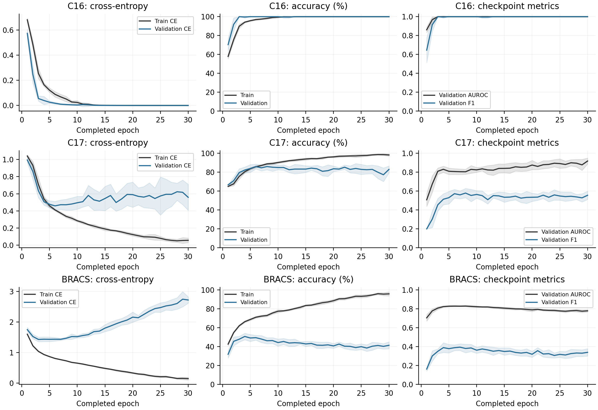
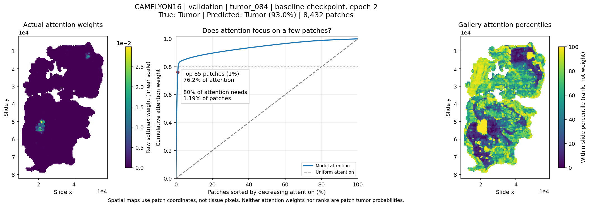
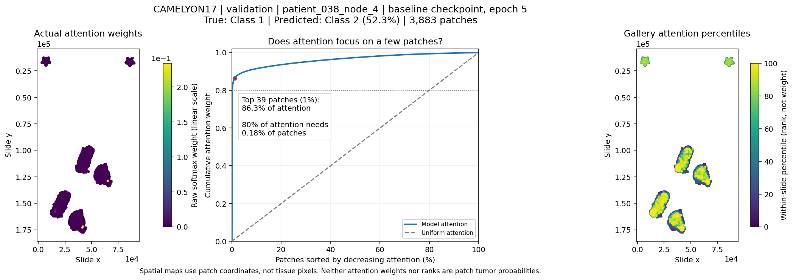
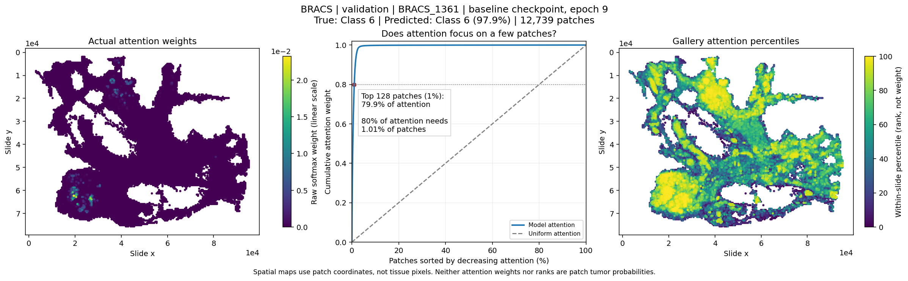
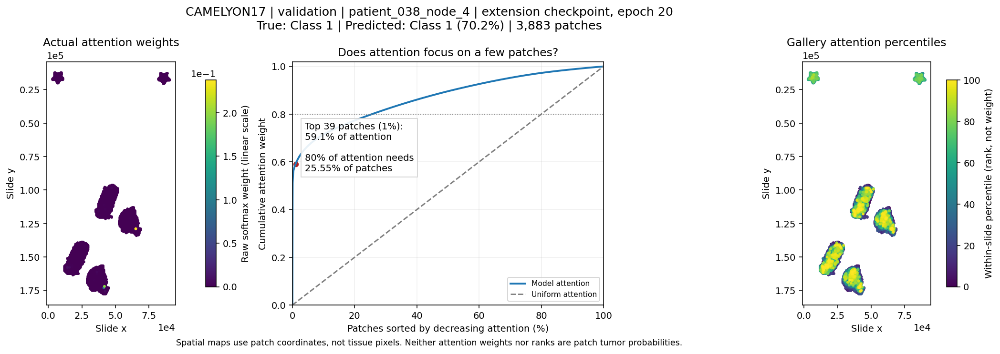

# ECE1512 Project A
## Whole-Slide Image Multiple Instance Learning
### Literature review, ABMIL baseline and two research ideas

Parteek Dheri · University of Toronto · October 2026

Repository: https://github.com/dheri/ECE1512_Project-A

**Summary.** This project completes the ABMIL notebook and evaluates two extensions on CAMELYON16 (C16), CAMELYON17 (C17) and BRACS. Gated spatial context improves mean accuracy by 2.02, 2.30 and 1.16 percentage points, respectively, but has metric-dependent tradeoffs. Masked-view consistency gives small, mixed changes. Results use ten paired training seeds on fixed splits.

## 1. Literature review and research questions

Whole-slide images contain many patches but usually have only a slide-level diagnosis. Multiple instance learning (MIL) treats each slide as a variable-size bag. Learned aggregation can retain diagnostic evidence that mean pooling dilutes or max pooling discards.

<!-- table-widths: 20,25,55 -->
| Method | Problem addressed | Main contribution |
| --- | --- | --- |
| ABMIL [1] | Fixed pooling ignores task-specific patch importance. | Learns normalized attention weights and a weighted bag representation from slide labels; gated attention combines tanh and sigmoid features. |
| CLAM [2] | Few labeled slides provide weak supervision. | Adds instance-level clustering constraints using high- and low-attention patches; class-specific branches support subtype discrimination. |
| DSMIL [3] | Sparse positive patches can be overwhelmed by other tissue. | Combines a max-pooling instance stream with a bag stream that relates patches to a critical instance; averages the streams' scores. |
| TransMIL [4] | Independent patch scoring misses relationships. | Uses correlated-instance transformer processing, approximate attention and multiscale positional encoding. |
| DTFD-MIL [5] | Many patches are available, but few independent slides. | Forms pseudo-bags, learns a first-tier MIL model and distills features for a second-tier slide prediction. |

**Comparison.** ABMIL changes pooling; CLAM adds instance constraints; DSMIL and TransMIL introduce patch relationships; DTFD-MIL changes bag construction and feature distillation. CLAM's pseudo-instance targets and DTFD's inherited pseudo-bag labels can be noisy. None creates new independent patients. Their published scores are not directly comparable with this project's feature release and splits.

**Research question 1.** Can agreement between full and partially masked bags improve ABMIL without adding inference parameters?

**Research question 2.** Can a small, gated neighborhood residual improve ABMIL while retaining its pooling and classifier?

The first question tests a training objective; the second tests local patch interaction. Both are implemented as adaptations of established consistency [11,12] and neighborhood/gating principles [13,14,15], not new mechanisms or reproductions of the reviewed architectures.

<!-- page -->
## 2. Complete the provided notebook: ABMIL baseline
### 2.1 Data, model and training

The supplied release [9] contains frozen 384-dimensional patch features, coordinates and slide labels. The exact image encoder, pretraining checkpoint, magnification and coordinate units are not documented. A feature dimension or filename does not identify the encoder.

Table 1. Course feature bags and frozen partitions. Classes: C16 = 2, C17 = 4, BRACS = 7.

{{table:datasets}}

**Model.** Each slide passes through a learned feature projection, gated-attention aggregator and linear classifier [1].

![Figure 1. Implemented gated ABMIL architecture [1]. The tanh and sigmoid branches multiply elementwise before scoring. Attention weights alpha_i pool the projected features h_i; C = 2, 4 or 7.](figures/architecture_baseline.png)

The projection, attention and classifier are trainable; the image encoder is not retrained. Pooling gives z = sum_i alpha_i h_i. Weights sum to one over real patches; padding is masked before softmax. Reordering real patches does not change the prediction.

**Training and evaluation.**

- Full training splits; batch size 1 slide; AdamW; learning rate 0.0001; weight decay 0.00001; dropout 0; 30 completed epochs; no learning-rate schedule or encoder fine-tuning.
- Training: clear gradients, forward pass, cross-entropy on raw logits, backward pass, optimizer step. Validation/test: evaluation mode with gradients disabled.
- Checkpoint: first epoch maximizing validation macro AUROC + macro F1. All 30 epochs still complete; test results do not select the epoch or seed.
- Test: full bags, ordinary unweighted cross-entropy (CE), accuracy, macro one-versus-rest AUROC and macro F1.
- Main comparison: three methods × three datasets × seeds 42–51 = 90 runs. Values are mean ± sample SD, not confidence intervals.

**C17 patient separation.** Centers 3–4 remain test data. Development centers 0–2 use the first valid fold of stratified, patient-grouped ten-fold splitting with random seed 42: 54/6/40 train/validation/test patients, with no overlap. Test slides and their order are unchanged. C16 and BRACS retain their frozen partitions.

<!-- page -->
## 2. Complete the provided notebook: baseline results
### 2.2 Test performance and learning curves

Table 2. ABMIL test results across ten seeds. Accuracy is percent; other metrics are unitless.

{{table:baseline}}

**Observations.**

- **C16:** strongest baseline; selected epochs are 2–3. The small, 27-slide validation set saturates early.
- **C17:** accuracy of 77.45% coexists with macro F1 of 0.5035. Majority classes dominate accuracy; minority recall remains weak.
- **BRACS:** training loss falls while validation loss rises. AUROC of 0.8057 does not imply strong seven-class decisions: accuracy is 42.21% and macro F1 is 0.3530.

These results motivate testing regularization and patch interaction, not selecting settings from the test set.

<!-- page -->
## 2. Complete the provided notebook: attention visualization
### 2.3 Candidate-region diagnostics

The examples use primary ABMIL seed 42: the first validation slide in saved order with label C16 = 1, C17 = 1 and BRACS = 6. Selection does not use correctness, confidence or attention.

**Interpretation.** High attention identifies candidate patches for review, not proven tumor. These are coordinate maps, not tissue-image overlays. Attention is relative within a slide, and percentile colors are ranks rather than tumor probabilities. Without region annotations, localization accuracy, segmentation quality and causal faithfulness cannot be established.

<!-- page -->
## 3. Propose two research ideas and evaluate them
### 3.1 Idea 1: full-to-masked prediction consistency

**Question.** Does agreement after deleting 10% of patches improve full-bag classification?

**Motivation and design.** A slide's diagnosis may be stable to a small random deletion. Encouraging agreement could reduce reliance on an accidental patch subset without adding inference parameters. However, deleting rare diagnostic patches can violate that assumption.

**Prior work and scope.** UDA uses detached original-input targets for augmentation consistency [11]. MHIM-MIL applies masked-instance mining and teacher–student consistency to WSI classification [12]. Unlike our variant, it uses attention-guided masking, an EMA teacher, bag-representation consistency and supervised classification on the masked student. Our experiment tests uniform random deletion and class-probability consistency within one ABMIL model, not a reproduction of either method.

![Figure 4. Masked-view training, related to consistency learning [11] and masked teacher–student MIL [12]. Both passes share the same current ABMIL parameters. The full prediction is detached only for KL; hard-label CE applies only to the full bag.](figures/architecture_consistency.png)

For every training bag, retain N′ = max(1, floor(0.9N)) patches, sampled uniformly without replacement. Let p be the full-bag prediction and q the retained-view prediction:

> L = CE(y, p) + KL(stopgrad(p) || q)

The KL weight and temperature are both 1. The full prediction is a detached target for the KL term, not an EMA teacher. The masked view receives no hard-label CE. Full-bag CE and masked-view KL gradients accumulate before one optimizer step. A dedicated seed-specific generator samples patches. Validation and test use full bags and ordinary CE.

**Expected benefit:** useful regularization at unchanged inference cost. **Risk:** the loss may be redundant or discourage sensitivity to sparse diagnostic evidence.

<!-- page -->
## 3. Propose two research ideas and evaluate them
### 3.2 Idea 2: gated local spatial context

**Question.** Does nearby patch context improve ABMIL without replacing its aggregator?

**Motivation and design.** Tissue neighborhoods may disambiguate a patch. A residual gate allows context to be added selectively rather than forcing every patch to use it.

**Prior work and scope.** Patch-GCN builds eight-neighbor spatial WSI graphs and combines message passing with attention pooling for survival prediction [13]. Mean-neighbor aggregation and self–neighbor feature combination have precedent in GraphSAGE [14]; learned transformed/bypass gating has precedent in Highway Networks [15]. Our single residual adapter is not Patch-GCN, GraphSAGE or an exact Highway layer: it keeps the identity path unscaled and gates only the added correction.

![Figure 5. Implemented spatial adapter, related to [13,14,15]. The scalar gate scales a 256-dimensional residual correction. The ABMIL head retains its separate attention gate (Figure 1).](figures/architecture_spatial.png)

For patch i, average the projected features of up to eight nearest other patches in the supplied coordinate frame. Concatenate that mean m_i with h_i:

> c_i = [h_i; m_i];  f(c_i) = Linear_256(ReLU(Linear_256(c_i)))

> g_i = sigmoid(w_g^T c_i + b_g);  h'_i = h_i + g_i f(c_i)

The context MLP maps 512 -> 256 -> 256; its final layer starts at zero. Gate weights start at zero and the bias gives g_i = 0.1. Baseline initialization is preserved, so initial logits match the paired baseline. The MLP and gate add 197,120 and 513 parameters. Attention and classification are unchanged; training uses ordinary CE.

Neighbors exclude the patch itself and use min(8, N−1); a singleton gets a zero neighbor mean. Coordinate/feature alignment, finiteness and uniqueness are checked. Coordinate distance is not a verified physical distance or tissue-connectivity measure.

**Expected benefit:** local interaction with a baseline-preserving start. **Risk:** extra capacity or incorrect neighborhoods may hurt generalization.

### 3.3 Fair comparison

Both extensions use the baseline's saved splits, seed grid, optimizer, epoch budget, checkpoint rule and metrics. Equal epochs do not mean equal computation: consistency adds a training pass, and spatial context adds parameters and neighbor processing.

<!-- page -->
## 3. Propose two research ideas and evaluate them
### 3.4 Main comparison: same splits and metrics

Table 3. All primary test results, mean ± sample SD over ten seeds. CE is unweighted test cross-entropy.

{{table:primary}}

Table 4. Paired extension-minus-baseline changes. Accuracy uses percentage points (pp). Wins are strictly positive accuracy/AUROC/F1 changes out of ten; ties are not wins.

{{table:paired}}

**Gated spatial context.** Mean accuracy improves on all three datasets. C17 also improves macro AUROC and F1; F1 improves in 9/10 seeds. The tradeoffs matter: BRACS AUROC falls by 0.0081, and C17 CE rises from 0.8059 to 1.0075. The method is not uniformly better.

**Consistency.** Accuracy changes are −0.39, −0.35 and +0.47 pp. This setting gives no broad advantage. It is a negative result for 90% retention and unit KL weight, not evidence that every consistency objective fails.

<!-- page -->
## 3. Propose two research ideas and evaluate them
### 3.5 Class-level errors across all datasets

- **C16:** Spatial reduces normal-to-tumor errors from 6.50% to 3.25%; mean tumor recall stays 78.16%.
- **C17:** With spatial, class-1/2 recall remains 11.88%/22.78%; 67.50% of class 1 is predicted as class 0.
- **BRACS:** Spatial raises class-4 recall from 18.33% to 30.00%, but lowers class-5 recall from 56.67% to 44.17%.

<!-- page -->
## 3. Propose two research ideas and evaluate them
### 3.6 Experimental observations and justification

**Minority classes remain a failure case.** C17 classes 0 and 3 account for 166/200 test slides. Spatial context improves class-1 and class-2 recall, but their absolute values remain low. There is only one class-1 validation slide, making selection fragile.

Table 5. C17 mean per-seed class recall; support is fixed across seeds.

{{table:c17_recall}}

**More seeds change the conclusion.** Within the same patient-disjoint cohort, the first three seeds give a spatial accuracy gain of +4.91 pp on C16 and −1.33 pp on C17. With ten seeds, these become +2.02 and +2.30 pp. A three-run conclusion can exaggerate a gain or reverse its sign. The ten-seed paired accuracy SDs are 3.04, 4.76 and 3.95 pp for C16, C17 and BRACS.

**Why the claims stay narrow.**

- All seeds reuse fixed test slides. Seed SD is not patient-level uncertainty or a confidence interval; no significance test is claimed.
- Better accuracy and AUROC can coexist with worse CE. No calibration or missing-patch robustness test was performed.
- Earlier test inspection influenced the final designs, so this is exploratory rather than untouched-test confirmation.
- The final gated model lacks a matched shuffled-coordinate control. Additional capacity, rather than useful geometry alone, may explain part of the gain.
- Feature provenance and coordinate units are incomplete; numeric C17/BRACS diagnostic mappings are unverified. No external or clinical validation is available.

**Earlier controls, kept separate.** The package retains 108 earlier runs, not extra seeds pooled into the main study. Ungated spatial context hurt BRACS; fixed and learned gates both recovered performance in three-seed controls. Shuffled-coordinate controls were mixed, so they do not prove a geometry-specific benefit. Class weighting improved some rare-class recalls but reduced C17 accuracy and macro F1. The first 90 historical runs had overlapping C17 training/validation patients; the later 18 weighting runs and all 90 primary runs use patient-disjoint partitions.

**Conclusion.** Gated local context is the more promising of the two tested ideas, with positive mean accuracy changes but clear metric and minority-class limitations. Consistency is a justified negative result at the tested settings. The useful outcome is a complete, inspectable MIL pipeline and a controlled comparison, not a claim of universal improvement.

<!-- page -->
## Reproducibility and references

**Report checklist.** Five-paper comparison and research questions; baseline model/training; splits and checkpoint rule; test metrics, curves and all nine confusion matrices; attention selection; architecture figures and prior-work attribution; both proposal designs; paired results, negative findings and limitations are documented.

**Code checklist.** Completed notebook, frozen splits, 90 primary prediction/history sets, 108 separate historical result sets, nine representative seed-42 checkpoints, figure sources, tests and result audit are included. Raw features/WSIs and the other checkpoints are not bundled. See `DATA.md` and `REPRODUCIBILITY.md`.

Repository: https://github.com/dheri/ECE1512_Project-A

**Attribution and inspection.** Course starter materials [10] supply the notebook structure and utilities; model/training/evaluation TODOs were completed and the pipeline extended. The two extensions adapt established principles [11]–[15] rather than reproduce those architectures. Architecture figures were drawn for this implementation; published figures and code from these five papers were not copied. Use `scripts/audit_results.py` to check saved results and the figure scripts to regenerate diagrams and plots. New training requires `reproduce.py --confirm-training` and separately acquired features.

<!-- columns -->
[1] M. Ilse, J. M. Tomczak, and M. Welling, “Attention-based deep multiple instance learning,” ICML, PMLR 80, pp. 2127–2136, 2018. https://proceedings.mlr.press/v80/ilse18a.html

[2] M. Y. Lu et al., “Data-efficient and weakly supervised computational pathology on whole-slide images,” Nature Biomedical Engineering 5, pp. 555–570, 2021. doi: 10.1038/s41551-020-00682-w. Open methods preprint: https://arxiv.org/abs/2004.09666

[3] B. Li, Y. Li, and K. W. Eliceiri, “Dual-stream multiple instance learning network for whole slide image classification with self-supervised contrastive learning,” CVPR, pp. 14318–14328, 2021. https://openaccess.thecvf.com/content/CVPR2021/html/Li_Dual-Stream_Multiple_Instance_Learning_Network_for_Whole_Slide_Image_Classification_CVPR_2021_paper.html

[4] Z. Shao et al., “TransMIL: Transformer based correlated multiple instance learning for whole slide image classification,” NeurIPS 34, pp. 2136–2147, 2021. https://arxiv.org/abs/2106.00908

[5] H. Zhang et al., “DTFD-MIL: Double-tier feature distillation multiple instance learning for histopathology whole slide image classification,” CVPR, pp. 18802–18812, 2022. https://openaccess.thecvf.com/content/CVPR2022/html/Zhang_DTFD-MIL_Double-Tier_Feature_Distillation_Multiple_Instance_Learning_for_Histopathology_Whole_CVPR_2022_paper.html

[6] B. Ehteshami Bejnordi et al., “Diagnostic assessment of deep learning algorithms for detection of lymph node metastases in women with breast cancer,” JAMA 318(22), pp. 2199–2210, 2017. doi: 10.1001/jama.2017.14585.

[7] P. Bandi et al., “From detection of individual metastases to classification of lymph node status at the patient level: The CAMELYON17 challenge,” IEEE TMI 38(2), pp. 550–560, 2019. doi: 10.1109/TMI.2018.2867350.

[8] N. Brancati et al., “BRACS: A dataset for BReAst carcinoma subtyping in H&E histology images,” Database, baac093, 2022. doi: 10.1093/database/baac093.

<!-- column -->
[9] L. Ye, “WSI Feature,” version 1, Zenodo, October 4, 2026. https://zenodo.org/records/23130543

[10] L. Ye, “ECE1512 Project A: Whole-Slide Image Multiple Instance Learning,” Lecture 5 and supplied starter materials, University of Toronto, October 7, 2026.

[11] Q. Xie et al., “Unsupervised data augmentation for consistency training,” NeurIPS, 2020. https://proceedings.neurips.cc/paper/2020/hash/44feb0096faa8326192570788b38c1d1-Abstract.html

[12] W. Tang et al., “Multiple instance learning framework with masked hard instance mining for whole slide image classification,” ICCV, pp. 4078–4087, 2023. https://openaccess.thecvf.com/content/ICCV2023/html/Tang_Multiple_Instance_Learning_Framework_with_Masked_Hard_Instance_Mining_for_ICCV_2023_paper.html

[13] R. J. Chen et al., “Whole slide images are 2D point clouds: Context-aware survival prediction using patch-based graph convolutional networks,” MICCAI, pp. 339–349, 2021. doi: 10.1007/978-3-030-87237-3_33.

[14] W. L. Hamilton, R. Ying, and J. Leskovec, “Inductive representation learning on large graphs,” NeurIPS, 2017. https://arxiv.org/abs/1706.02216

[15] R. K. Srivastava, K. Greff, and J. Schmidhuber, “Highway networks,” arXiv:1505.00387, 2015. https://arxiv.org/abs/1505.00387
<!-- /columns -->
